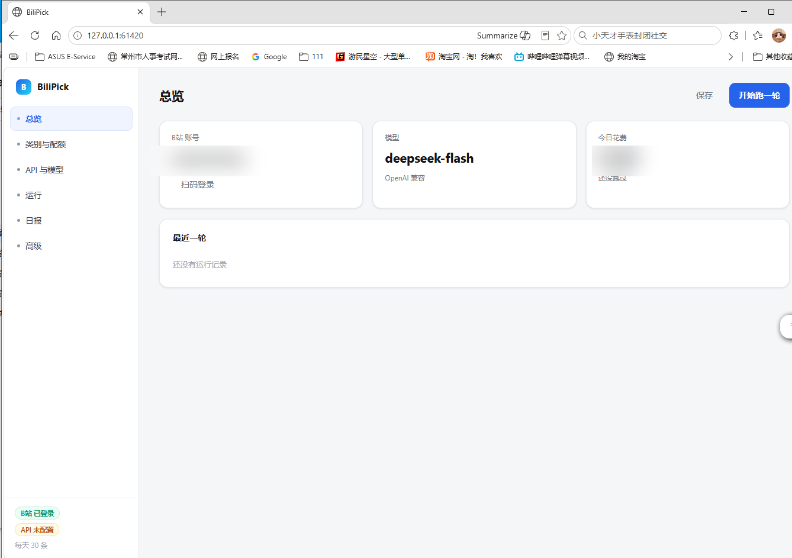

# BiliPick

**[简体中文](README.md) · [English](README.en.md)**

> Curate Bilibili every day: pick videos by category quota, drop the good ones into **Watch Later**, and keep a daily digest with reasons.

[](LICENSE)
[](https://www.python.org/)
[](#quick-start)
[](#model-apis)



> ## ⚠️ Relationship to upstream: almost a complete rewrite
>
> This project is a fork of [dsh-bili-scroll](https://github.com/c1overzz/dsh-bili-scroll), but **not a patch or a branch of it — it is almost a rewrite**:
>
> - **No code reuse**: upstream is a DSH plugin (`index.js`, `client.js`, `lib/*`, bundled Python MCP); this project is a standalone `app.py` + `engine.py` + `web/index.html` and does not depend on DSH.
> - **Only the product idea is shared**: browse Bilibili for you, read subtitles to decide what is worth watching, deliver the good stuff — plus lessons baked into the original prompt charter.
> - **Very different shape and features**; see [docs/CHANGES.md](docs/CHANGES.md) for a side-by-side list.

---

## Why BiliPick

- **Category quotas**: Tech / Science / Life / ACGN / Other with default **5 / 5 / 5 / 10 / 5 = 30 videos per day**; categories, counts, keywords and thresholds are all editable.
- **Reads subtitles and comments before judging**: the model must quote a subtitle line as evidence; top comments complaining about clickbait or fluff lower the score, comments adding substance raise it.
- **Quality gate**: a composite score of plays / likes / favorites / danmaku / comments filters candidates; anything below the category threshold is dropped.
- **Only touches Watch Later**: no public comments, no @-mentions, no uploads, no dynamics, no DMs.
- **Four-way dedupe**: followed creators (full list), Bilibili watch history, past recommendations, and current Watch Later; runs **at most once per daily quota**.
- **Budget-aware**: default **¥3/day and 10 minutes per run**; accounting per API call with idle/peak pricing; stops on either limit.
- **Multiple model APIs**: OpenAI-compatible / Anthropic / Gemini / custom JSONL; API key and model are left blank for the user.
- **Runs locally**: browser UI, loopback-only server with a random token; a Python-free Windows bundle can be built.

## How it works

```text
category keywords × 2 sort orders (last N days)
        │
        ▼
free filters: followed creators / watch history / past picks / Watch Later / blocklist / quality floor
        │
        ▼
rank per category by quality score → LLM shortlist (title · description · uploader · duration · plays)
        │
        ▼
fetch subtitles + top comments for the top N per category
        │
        ▼
LLM scoring: 0–10, required subtitle quote, comment signal
        │
        ▼
take the best per quota → add to Watch Later → write a daily digest with cost
```

## Quick start

### Option A — prebuilt (Windows)

1. Download `BiliPick-win64.zip` from [Releases](https://github.com/812147495lz-max/dsh-bili-scroll/releases) (or build it with `build-exe.bat`)
2. Extract and double-click `BiliPick.exe`
3. The browser opens <http://127.0.0.1:61420/>

> Unsigned PyInstaller binaries are sometimes flagged by Windows Defender; allow it or exclude the folder.

### Option B — from source

```bash
git clone https://github.com/812147495lz-max/dsh-bili-scroll.git
cd dsh-bili-scroll
git checkout bilipick

python -m venv .venv
.venv\Scripts\pip install -r requirements.txt   # Windows
# .venv/bin/pip install -r requirements.txt     # macOS / Linux
.venv\Scripts\python app.py                     # or: python app.py
```

Requires **Python 3.10+**. To build the Python-free Windows bundle: `build-exe.bat`.

## Usage

1. **API & model**: choose a protocol and paste an API key (stored only in `data/config.json`)
2. **Bilibili account**: scan the QR code (stored only in `data/credential.json`)
3. **Categories & quotas**: edit categories, keywords, per-day counts, deep-review counts and thresholds
4. Click **Save**, then **Run once**; check the digest and cost afterwards

## Categories and judging

| Parameter | Meaning |
|---|---|
| Keywords | Used for searching and classifying into this category |
| Per-day quota | Videos wanted per day (total quota = sum over categories) |
| Deep-review cap | How many candidates this category gets full subtitle/comment review |
| Quality floor | Minimum composite score from plays/likes/favorites/danmaku/comments |
| Score floor | Minimum LLM score (0–10); below it a video is dropped |

## Model APIs

| Protocol | Default base URL | Default model |
|---|---|---|
| **OpenAI-compatible** (DeepSeek / Moonshot / Qwen / Ollama / vLLM / one-api …) | `https://api.deepseek.com` | `deepseek-flash` |
| **Anthropic** | `https://api.anthropic.com` | `claude-sonnet-4-5` |
| **Gemini** | `https://generativelanguage.googleapis.com` | `gemini-2.5-pro` |
| **Custom JSONL** (JSON body or `data: {...}` stream) | your full URL | your model |

## Dedupe and budget

- **Dedupe**: followed creators (fully paginated), watch history, past picks/evaluations, current Watch Later
- **Daily quota**: once the quota is reached, another run is skipped until the next day
- **Budget**: ¥3/day by default (stops at 90%), accounted per call; stops on budget or time limit and says so in the digest

## Project layout

```text
app.py            local HTTP server + browser UI (single instance, random token)
engine.py         search · classify · quality · dedupe · shortlist · judge · Watch Later · digest
web/index.html    frontend (vanilla JS, no build step)
requirements.txt  bilibili-api-python / aiohttp / qrcode / Pillow
start.bat         run from source
setup.bat         create venv and install dependencies
build-exe.bat     PyInstaller bundle (onedir, no Python needed)
docs/CHANGES.md   item-by-item differences from upstream
data/             runtime data (config / credentials / digests / cost; gitignored)
```

## FAQ

<details>
<summary><b>It shows "Bilibili logged in" — is that someone else's account?</b></summary>

No. The app is single-instance: if a BiliPick is already running, launching another copy just opens the running instance. Data lives in `data/` next to the executable.
</details>

<details>
<summary><b>I clicked "Run once" and nothing happened</b></summary>

Check the Run log: (1) API key missing, (2) Bilibili not logged in, (3) the daily quota is already met — it skips until the next day, or raise a category quota.
</details>

<details>
<summary><b>Windows Defender flagged / deleted the exe</b></summary>

A common false positive for unsigned PyInstaller builds. Add an exclusion or run from source.
</details>

<details>
<summary><b>Is my data uploaded anywhere?</b></summary>

No. Everything stays in local `data/`; the distributed bundle contains no personal data.
</details>

## Roadmap

- [ ] One-click "clean export" bundle without `data/`
- [ ] Automated Windows build on GitHub Releases
- [ ] Feedback loop in the digest ("useful / not useful / seen")
- [ ] More category templates and config import/export

## Contributing

Issues and PRs are welcome. See [docs/CHANGES.md](docs/CHANGES.md) for the relationship with upstream first. Commit messages can be Chinese or English.

## License & acknowledgements

[MIT](LICENSE) © 2026 BiliPick contributors

- Product idea and prompt-charter lessons: [c1overzz/dsh-bili-scroll](https://github.com/c1overzz/dsh-bili-scroll) (MIT)
- Bilibili APIs: [bilibili-api-python](https://github.com/Nemo2011/bilibili-api) (MIT), [adoresever/bilibili-mcp](https://github.com/adoresever/bilibili-mcp) (MIT)

This is an independent rewrite and is not affiliated with the projects above.
